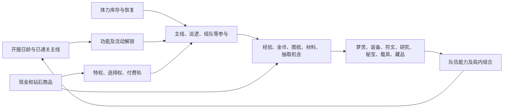

# 《梦境护卫队》成长线资源依赖图

核查日：2026-10-15（北京时间）。本文件补充[商业化与成长线基线](商业化与成长线基线.md)的成长部分，供以后逐道具改价、改投放、改解锁时使用。**“当前配置”只表示本地 trunk 正式 XML 快照；功能是否在运行服开放、奖励是否实发仍未验证。**“规划产出”只表示策划表中的模型，不等于实际玩家每天取得的数量。

## 1. 共同约束与主循环

主线是双重闸门：推进本身受战斗结果、体力和关卡前置约束；推进后又开放资源入口和新的养成消耗口。正式[主线配置](<E:/x1/配置/trunk/xml_gy/normal/Z_主线推图_chapter_pve_data.xml>)`章节配置!9:10`中，前两关 `energy_cost=10`，第二关 `open_condition=[{chapter_pve,1}]`，并分别列首通、固定和条件奖励。正式[玩家等级配置](<E:/x1/配置/trunk/xml_gy/normal/W_玩家等级_leader_data.xml>)`等级!3:4`中，经验阈值、体力上限和恢复间隔分字段配置。策划[1-1 玩家等级](<E:/x1/配置/trunk/策划文档/数值文档/《梦境护卫队》1-1玩家等级.xlsx>)`玩家升级!D7:K19`把广告、食堂、礼包、购买等体力来源混在不同付费层级，因而不能把表内合计直接当所有人的实际日供给。

功能解锁需区分**通关** `chapter_pve` 和**挑战过** `challenge_chapter_pve`。**DreamGuard Knowledge 索引证据**：Wiki `dg-server-engineering`、project `server`、仓库相对路径 `src/util/condition.erl:L152-L180` 分别根据挑战存活时间和通关标记判断；`src/util/condition.erl:L32-L48` 对同一条件列表逐条检查，故列表内多项同时满足；`src/mod/func_open/role_func_open.erl:L284-L305` 对 `condition_2` 作备选条件判断。代码为索引快照，运行服未验证。

## 2. 当前配置的主要解锁闸门

下表直接取[功能开启配置](<E:/x1/配置/trunk/xml_gy/normal/G_功能开启_func_open_data.xml>)`功能开启`页的条件字段。`create_day=999` 按配置仅在角色第 999 天达到，不能当本轮正常新服入口；是否存在其他跳转或 GM 途径，本表不推断。

| 功能或入口 | 配置条件 | 配置行 | 成长含义与边界 |
|---|---|---:|---|
| 梦灵招募、商店／每日特惠 | 通关第 2 关 | 6、66、112 | 早期抽取与购买入口；获得招募道具不等于已招募、已升级。 |
| 每日任务／周任务 | 分别通关第 3／8 关 | 4、12 | 任务奖励需要再检查参与、完成和领取事件。 |
| 体力战令、能量站、周卡 | 通关第 4 关 | 5、52、111 | 战令满级价值须以任务进度、购买时间和已领取状态约束。 |
| 符文初愿、符文秘藏 | 通关第 5 关 | 49–50 | 符文产出入口解锁早于高阶符文毕业；合成和洗练另有消耗。 |
| 武器研究 | **挑战过**第 7 关 | 21 | 与“通关第 7 关”不是同一条件。 |
| 梦域巡航／多倍巡逻 | 通关第 10 关 | 31、144 | 装备、符文与材料的规划产出不能在此关前按日累加。 |
| 秘宝 | 通关第 30 关 | 105 | 早期秘宝产出若可提前持有，也不等于可提前完成秘宝养成。 |
| 公会 | 开服第 3 天，角色等级 10 | 117 | 公会产出应按两项前置和实际参与率建情景。 |
| 载具、载具抽取、梦隙迷廊 | **开服第 22 天且通关第 60 关** | 139–142 | 未开放时发放的零件本体按索引发奖逻辑转对应碎片，不能简单记作本体库存；精密齿轮等其他材料仍需逐类核对。索引证据：Wiki `dg-server-engineering`／project `server`／`src/mod/item/item_lib.erl:L565-L588`，运行服未验证。 |
| 藏品 | 开服第 15 天，**或**已激活一件藏品 | 149 | 第二条件在 `condition_2`，按索引服务端为备选而非与第 15 天叠加；运行服仍待验。 |
| 装备总入口、金币副本、装备强袭 | `create_day=999` | 13、22、60 | 表明这些**具体入口**在正常早期不可按规划默认开放；分解／强化／洗炼另有独立配置行 136–138，需运行界面与事件确定可达路径。 |

日龄条件与角色创建日条件不是一个时钟。索引代码 `server/src/util/condition.erl:L100-L126` 将 `server_open_day` 读取服务器开服日、`create_day` 读取角色创建日；新进老服玩家与首日建角玩家的解锁时间可能不同。这里是**知识库索引事实**，不是实际服开关证明。

## 3. 资源库存、消耗和反馈路径

表内“规划来源”均为资源**候选入口**，后续模拟须以当期配置和领取流水筛掉不可用渠道。特别是[3-0 产出总览](<E:/x1/配置/trunk/策划文档/数值文档/《梦境护卫队》3-0产出总览.xlsx>)`金币平衡!B6:G22`、`图纸产出设计!B6:E24`已有 `#N/A`，不能汇总成精确日净产。

| 库存／成长节点 | 当前配置中的消耗或约束 | 策划规划中的主要来源、付费接点 | 测算时的关键检查 |
|---|---|---|---|
| **体力 → 主线、经验、其他玩法** | 主线各关有体力消耗；恢复受上限和时间制约。主线收益有首通、固定、条件三层，不能每次都计首通。见 `Z_主线推图/章节配置!9:10`、`W_玩家等级/等级!3:4`。 | [1-1](<E:/x1/配置/trunk/策划文档/数值文档/《梦境护卫队》1-1玩家等级.xlsx>)`玩家升级!D7:K19`列时间恢复、广告、食堂、免费／付费礼包和钻石购买。 | 同时记录体力溢出、广告观看、食堂领取、关卡失败、购买上限；投入体力不保证通关。 |
| **钻石 → 商店、额外抽取及材料补缺** | 以每个商品的现行支付字段为准，购买后钻石出账；现金直购与钻石包分账户处理。 | [3-0](<E:/x1/配置/trunk/策划文档/数值文档/《梦境护卫队》3-0产出总览.xlsx>)`巡逻产出!A1:M13`、`竞技场!A9:E17`、`主线宝箱!A1:N20`等列规划入口；现金、月卡与活动为额外入口。 | 免费钻石、现金充值钻石、活动券不能因同为“价值”而在库存里重复记入。 |
| **金币 → 多条养成竞争** | 正式[装备配置](<E:/x1/配置/trunk/xml_gy/normal/D_队长装备_captain_equip_data.xml>)`强化等级!3:4`一例同时耗部位图纸与金币；[武器研究](<E:/x1/配置/trunk/xml_gy/normal/J_基因_evolve_data.xml>)`进化!3:4`耗金币及后续材料；[载具](<E:/x1/配置/trunk/xml_gy/normal/Z_载具养成_vehicle_data.xml>)`零件升级!3:5`、[藏品](<E:/x1/配置/trunk/xml_gy/normal/C_藏品_antique_data.xml>)`升星消耗!3:5`的高阶节点也耗金币。 | `3-0/金币平衡!B6:G22`列装备分解、主线、巡逻、组队、任务等规划来源；其中金币本入口正式功能配置为 `create_day=999`。 | 金币是**跨系统共享资源**；是否成为实际瓶颈须按同服龄玩家库存与净产出验证，调整某一线金币成本须复算其他线可升级数量。 |
| **梦灵本体／碎片与经验 → 梦灵等级、图鉴、编队** | 正式[单位配置](<E:/x1/配置/trunk/xml_gy/normal/D_单位_unit_data.xml>)`卡牌升级!3:8`按品质、等级列 `exp_count` 和 `piece_count`。**知识库索引事实**：Wiki `dg-server-engineering`、project `server`、`src/mod/role_unit/role_unit.erl:L547-L566` 的升级路径检查两类成本后消费；运行服未验证。 | [2-1 梦灵养成](<E:/x1/配置/trunk/策划文档/数值文档/《梦境护卫队》2-1梦灵养成.xlsx>)`梦灵本体产出!D6:N30`有抽取阶段规划，`梦灵经验产出!A3:N30`有经验投放模型；招募器和特定碎片进入商业化。 | 先分本体、对应碎片、通用碎片、经验；按玩家**已持有角色与实际队伍**计算边际战力，不能把整卡面价当每个玩家都能即时使用。 |
| **装备本体、部位图纸、锻造晶石 → 强化与洗炼** | `D_队长装备/常量!3:9`为六部位初始装备；`强化等级!3:4`第一部位示例耗头盔图纸 `50003` 和金币；`洗炼消耗!8:9`耗锻造晶石 `50001`。道具名见[道具配置](<E:/x1/配置/trunk/xml_gy/normal/D_道具_item_data.xml>)`道具信息!645:647`。 | [2-4 装备养成](<E:/x1/配置/trunk/策划文档/数值文档/《梦境护卫队》2-4装备养成.xlsx>)`装备产出!D18:P32`以组队本品质概率建模；`3-0/组队产出!A4:N19`、`巡逻产出!A1:M13`列材料入口。 | 区分“装备本体价值”和同件装备追加的图纸、金币、洗炼石；拆解返还不能当全部投入回收。旧 2-4 的“强化书”口径与正式部位图纸字段不完全相同。 |
| **符文本体、符引结晶、祝福石 → 合成／重铸／心愿** | 正式[符文配置](<E:/x1/配置/trunk/xml_gy/normal/F_符文_rune_data.xml>)`符文合成!3:4`相邻品质以 4 枚合 1 枚；`符文重铸!3:4`耗符引结晶 `5303001`；`心愿洗练!3:9`另耗传说祝福石 `5305010`。 | [2-0 养成预期](<E:/x1/配置/trunk/策划文档/数值文档/《梦境护卫队》2-0养成预期.xlsx>)`符文总览!A1:T19`列现行命名与品质权重；`3-0/主线推图!A3:L18`、`巡逻产出!A1:M13`、`组队产出!A4:N19`规划普通符文和结晶入口。 | 合成是本体库存的**转换**而非新净产；按目标品质、部位和属性的联合概率评估，不可只按“一个高阶符文”面价估完工成本。 |
| **织梦微尘、潜能棱晶、金币 → 武器研究** | `J_基因/进化!3:425,427:849`有 `pre_evolve`、`unlock_condition`、`need_cost` 和 `time` 字段；共两组、每组 420 节点且本轮 ID／成本相同，同一角色不能双算。组 2 全部节点需 6,988,720 金币、307,368 微尘、420 棱晶；`time` 无非零值，见[逐节点核对](growth_late_systems.md)。 | `3-0/基因平衡!B6:G12`仍用旧“基因”口径列主线任务、组队、公会、每日任务规划供给；任务中“进行研究”见 `3-0/任务!A24:O30`。 | 研究是**前置节点图**，不是单一线性进度条；当前配置无等待时间，不得沿用[2-2 基因养成](<E:/x1/配置/trunk/策划文档/数值文档/《梦境护卫队》2-2基因养成.xlsx>)的旧时间假设。 |
| **秘宝本体、转运石 → 洗炼并累计等级／技能** | 正式[秘宝配置](<E:/x1/配置/trunk/xml_gy/normal/M_秘宝养成_treasure_data.xml>)`常量!4:8`将等级累计消耗道具指向转运石 `5523001`；`秘宝等级!3:14`列**累计门槛**，`洗炼消耗!3:4`列每次消耗。**DreamGuard Knowledge 索引证据**：Wiki `dg-server-engineering`、project `server`、仓库相对路径 `src/mod/captain_treasure/role_captain_treasure.erl:L811-L830,L518-L525` 显示洗炼消耗同时累积经验并重算等级；运行服未验证。 | [2-5 秘宝养成](<E:/x1/配置/trunk/策划文档/数值文档/《梦境护卫队》2-5秘宝养成.xlsx>)`秘宝产销!B5:J16,B21:G37`规划公会、竞技场、主线等入口；`3-0/公会!A2:M25`是另一版公会投放。 | 不能把“等级累计转运石＋洗炼转运石”重复相加。2-5 规划写第 15／30 关开放两套秘宝，当前总功能闸门却是通关第 30 关，须按正式门槛做供给到消耗的时序。 |
| **载具本体／碎片、精密齿轮、金币 → 零件等级与套装** | `Z_载具/常量!3`列解锁赠智械发条和精密齿轮；`零件!3:5`含本体与碎片 ID；`零件升级!3:5`耗碎片和金币；`载具等级!3:5`耗精密齿轮 `63`；`套装!3:5`有指定零件／标签门槛。索引发奖路径中，功能未开放时零件本体转对应碎片，重复本体也转碎片：Wiki `dg-server-engineering`／project `server`／`src/mod/item/item_lib.erl:L565-L629`，运行服未验证。 | [2-6 载具养成](<E:/x1/配置/trunk/策划文档/数值文档/《梦境护卫队》2-6载具养成.xlsx>)`载具产出!D6:N19`规划抽取、品质和阶段；相关新服付费礼包若售零件，需按当前抽池与阶段核价。 | 先过“开服第 22 天且第 60 关”，再看角色是否有特定零件、碎片和齿轮；同名零件抽取的期望与套装指定件完工成本不同。 |
| **藏品本体／碎片、金币 → 星级与套装、二阶增产** | 正式[藏品配置](<E:/x1/配置/trunk/xml_gy/normal/C_藏品_antique_data.xml>)`藏品!3:6`绑定本体与碎片 ID；`升星消耗!3:5`耗碎片、金币；`升星配置!3:6`及`套装!3:6`列属性与组合条件。 | [3-7 藏品](<E:/x1/配置/trunk/策划文档/数值文档/《梦境护卫队》3-7藏品.xlsx>)`竞技场产出!A4:J12`、`梦隙迷廊产出!A4:J12`、`组队&彩虹关!A4:K12`列拟议增产通道；`总览!B3:D8`仍写多个条目待最终参数。 | 藏品可反过来提高其他玩法产出，形成**二阶反馈**。在触发条件和上线产出未确认前，不把 3-7 中的收益估算叠加到基础日供给。 |

上述依赖不是“所有货币按钻石相加”模型。每个资源单独守恒：

`次日期初库存[r] = 当日期初库存[r] + 已领取免费产出[r] + 已到账付费产出[r] + 转换产出[r] − 玩法门票[r] − 养成消耗[r] − 转换投入[r]`。

符文合成、装备分解、箱池开启与抽卡是**资源转换**，须两边同时记账。机会型权益（跳广告、刷新上限、较高容量）是可用次数或效率改变，不能按固定道具流入填写。随机奖励须保留奖池状态和概率；只是打开某个入口，不能把整池期望在解锁日记入库存。

## 4. 冲突与可用性登记

| 旧／规划材料 | 较新或更直接的证据 | 本图处理 |
|---|---|---|
| [1-0 数值总表](<E:/x1/配置/trunk/策划文档/数值文档/《梦境护卫队》1-0数值总表.xlsx>)`养成框架!D64:E77`非 R 目标 D1=10、D7=33、D14=47 关 | 较新的 `3-0/产销汇总!C13:D26`为 D1=10、D7=40、D14=57 关 | 后者仅作**当前规划目标**；角色实绩用同服龄关卡分布检验。 |
| `2-0/总览!B28:L33`体力层级 210／280／420／560／720 | `1-1/玩家升级!D9:H12`免费来源累计约 400；`3-0/产销汇总!D6:G6`另列 210／280／420／340 | 分别作为分层预算、来源清单、产销模型；无一项可直接宣称线上实际日供给。 |
| `2-6/养成规划!D5:L6`载具“29 天＋50 关” | `G_功能开启/功能开启!139:142`为开服第 22 天、通关第 60 关 | 用正式 XML 作配置快照基线；旧表保留为修订前设计意图。 |
| `2-2`基因养成及`3-0/基因平衡`旧命名与旧时间推演 | `J_基因/进化`现行称“武器研究”，有前置、金币与材料、`time=0` | 不将旧研究等待时间、旧基因等级当当前进度。 |
| [2-3 宝石养成](<E:/x1/配置/trunk/策划文档/数值文档/《梦境护卫队》2-3宝石养成.xlsm>)旧称“宝石” | `2-0/符文总览`及 `F_符文_rune_data.xml` 当前为符文 | 旧概率／消耗只作版本史，不跨名称自动拼接。 |
| `2-4/说明`与`2-5/说明`有复制旧系统文字；`3-7/总览`注明部分藏品未最终对齐 | 各系统正式 XML 列可执行字段；规划供给仍有待核部分 | 取正式字段定义养成消耗；设计页仅提供目标与候选来源，未确认的增益不进基线。 |
| `3-0/金币平衡!B2:G22`、`图纸产出设计!B2:E24`计算链含 `#N/A` | 现行正式配置给每一消耗节点，但没有在这些表中形成闭合的日净产 | 暂不能计算确定的“满级天数”或跨系统最优购买顺序。 |
| [7-1 数值优化](<E:/x1/配置/trunk/策划文档/数值文档/《梦境护卫队》7-1数值优化.xlsx>)为旧版优化记录 | 本轮检查的正式配置与近期 2-0、2-1、3-0 | 只用于解释修订缘由，不覆盖当前配置。 |

## 5. 后续改动如何接入

1. 定义**同一个目标节点**，例如“首次通关第 60 关并解锁载具”或“指定梦灵升到等级 N”。目标须同时写通关、日龄、角色等级、前置研究以及具体库存要求；缺任一条件就不能输出完成日。
2. 商品奖励按道具 ID、数量和入账日接入上面的库存。现金商品面价用于核价，实际可用资源用于成长测算；二者保留两套指标。首充特殊促销单列，不强行加入日常礼包返比排序。
3. 对免费、低付费、中付费等人群，从相同服龄／关卡／已有库存开始模拟。若某商品只增加非瓶颈资源，名义返比可能很高，但本目标的提前天数可为零。
4. 结果写为 `T0`（未购买时最早达成日）、`T1`（购买后最早达成日）、`ΔT=T0−T1`，并列最晚满足的闸门及其所缺资源。**目前没有足够的线上资源流水、活动可见记录和完整无错产销链来填确定数值**，故本图只给结构，不虚构时间。
5. 上线回看时按角色建角日、服务器开服日、通关记录、体力来源与消耗、道具增减流水、抽取保底状态、各功能参与／领取及付款 SKU 连接。当前主报告引用的小游戏主线队列可作进度分布校准，不能用宽渠道订单量替代同一队列购买率。

