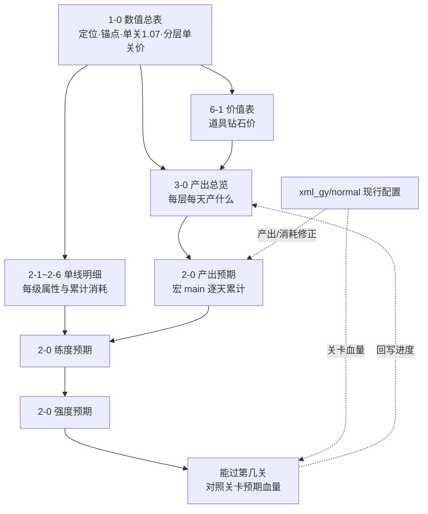

# 《梦境护卫队》数值规划表复盘（养成与资源产消）

## 0. 读这份文档前要知道的规则

1. **权威顺序**：`xml_gy/normal` 现行配置 > 《6-1商业化数值2.0版》价值表 > 各规划表。规划表和配置冲突时，以配置为准并回改规划表。同一配置有多段开服日期划断时，以最新一段为准。
2. **一个核心公式**：每关怪物血量约 +7%（1-0 写作“单关 1.07”，配置 `G_怪物` 第 20 关起实测约 +7%）。所以任何养成给的倍率 X，都折合 `log1.07(X)` 关。+20% ≈ 2.69 关，×2 ≈ 10.2 关，×10 ≈ 34 关。
3. **一个价值单位**：1 元 = 10 钻。每个道具在 6-1「价值表」有固定钻石价（是“等值”，不是售价）。产出、礼包、坑深都按钻石算。
4. **两把尺子之间的桥**：一个养成点的“单关价格” = 达到它要花的钻石 ÷ 它给的关卡数。定价时看这个价格落在哪一层的锚定线上（见 2.3）。
5. **道具改过名**，旧表和新表是同一个东西（见 2.5 别名表）。表里的道具名是宏和公式的查找键，所以旧表里的名字没有改。

## 1. 文件地图与数据流

| 文件 | 角色 | 一句话 |
| --- | --- | --- |
| 1-0 数值总表 | 设计源头 | 定每条养成线的定位、天数×关卡锚点、单关 1.07、分层单关价格、赛季坑深 |
| 6-1 商业化数值2.0版 | 价格权威 | 每个道具的钻石价值；礼包、月卡、战令、各活动的定价与返利 |
| 1-1 玩家等级 | 等级线 | 1 体力 = 6 经验；按各层每日体力推玩家等级 |
| 3-0 产出总览 | 供给 | 各分层主线进度、每日玩法次数；各玩法“产出_xxx”表；资源平衡核算；直接生成配置奖励串 |
| 2-0 养成总览 | 产出→练度→强度→关卡 | 宏读 3-0，算出某层某天能养到哪、能打到第几关 |
| 2-0 养成预期 | 性价比 | 各模块“再多过 1 关要花多少钻”随时间的变化 |
| 2-0 符文调优 | 符文细调 | 符文洗练的期望坑深、各档权重 |
| 2-1/2-2/2-3/2-4/2-5/2-6 | 单线明细 | 梦灵/基因/宝石(旧符文)/装备/秘宝/载具 的每级属性、消耗、产出，部分页直接导出配置 |

## 2. 全局规则与常量

### 2.1 单关 1.07
- 1-0「属性规划（旧）」第一句：角色面板以第 10 关为基础，之后每关释放 7% 给各系统。「属性规划(新)」D39 = 1.07。
- 表里所有 `LOG(x,1.07)` 都是在把倍率换成关卡数。
- 2-0「关卡预期」E 列 = 100 × 配置关卡血量比（第 1 关 = 100）。

### 2.2 价值表（6-1）
- 位置：6-1「价值表」B4:L287。列：道具名称、道具ID、类别、钻石价值、RMB等值、途径、标准折扣、备注、整体思路。
- 关键价：钻石 1、体力 2、金币 0.05、招募器 30、梦愿水晶 100、神灯 100（10-20 当天改过，此前 120/150）、装备图纸 3、锻造晶石 0.1、能量特饮 1、织梦微尘 3、潜能棱晶 500、星之初愿 50、星辉秘契 280、符引结晶 5、幻梦晶核 60、符文 16→64→256→1024→4096→16384→65536（每级 ×4 = 4 合 1）、加速沙漏已移除。
- 梦灵本体 稀有 60 / 史诗 120 / 传说 250 / 神话 1000；碎片 6 / 12 / 25 / 100。
- “标准折扣”是该道具在礼包里的常见价值倍数（如招募器 6、金币 5、符文材料 8）。
- 下半部（约 189 行起）是“条件价”：只在特定活动、特定箱子里成立的价，不能当全局价用（备注里写了“勿回填”）。
- **其它工作簿里的价值表是 6-1 的副本**（1-0 商业化框架、2-0 养成总览、2-0 养成预期、2-0 符文调优、2-1、2-6、3-0 两列）。10-20 已把数值统一到 6-1；以后改价只改 6-1，再同步副本。

### 2.3 分层锚定与单关价格（1-0「属性规划(新)」C41:G45）
同样是 +20% 的体验，各层愿意花的钱不同：

| 分层 | 预期花费（钻） | 单关价格（钻/关） | 单关价格（元/关） |
| --- | --- | --- | --- |
| 超R | 50,000 | 18,555 | 1,855 |
| 大R | 10,000 | 3,711 | 371 |
| 中R | 3,000 | 1,113 | 111 |
| 小R | 1,000 | 371 | 37 |

公式 `单关价格 = 预期花费 / LOG(1.2, 1.07)`。付费养成点算出单关价格后用 `MATCH(单关价格, E42:E45, -1)` 自动归层。皮肤还加一项“白板攻击 × 5 钻/点”（「皮肤倍率不保值，攻击做保值」）。

### 2.4 养成线定位（1-0「养成框架」D8:L17、「属性规划(新)」C6:M12、「商业化框架」D14:N22）

| 养成线 | 商业化定位 | 每 60 天周期局外拓展 | 赛季坑深（钻） | 付费比重 | 在 2-0 强度公式里 |
| --- | --- | --- | --- | --- | --- |
| 装备（强化+品质+洗练） | 无商业化，活跃 | 10 关 | 强化 420,000；洗练 105,000 | 10%；60% | 加法基础攻击 + 洗练乘区 |
| 基因研究 | 活跃为主 | 对标装备 | 112,500 | 25% | （2-0 未单列） |
| 梦灵（本体+升级） | 弱商业化，强反馈 | 20 关 | 碎片 1,155,000；经验 945,000 | 60% | 乘区 |
| 符文（本体+洗练） | 强商业化，弱反馈 | 80 关 | 本体 1,081,344；洗练 240,000 | 87%；97.5% | 加法符文攻击 + 乘区 |
| 秘宝 | 活跃+付费 | — | — | — | 乘区 |
| 皮肤 | 付费，强反馈 | 0 关（卖门槛强度） | 按件 | — | 不在 2-0 |

其它锚点：
- 天数×关卡线：14 天 50 关（大R 7 天）、30 天 70 关、60 天 100 关、120 天 150 关。
- 天数×等级线：14 天 56 级、21 天 63 级、28 天 70 级；前期 2 天一个等级段，40–50 级 4 天一段，34 天后 2 周换代。
- 新手期：前 10 关靠首通和三星宝箱平衡步长。
- 梦灵品质倍率：1.15 / 1.3 / 1.65 / 3.3，之后每个新品质 ×2（=约 10 关），60 天一个新品质；等级成长锚 10%/级；单梦灵 25 级极限；新品质 10 级 > 旧品质 25 级。
- 符文：非R 3 个周期养到 60%，超R 单周期养满；“大R 一身红宝石 + 一个彩，非R 一身橙”。

### 2.5 道具别名（旧名 → 现名）

| 旧名（旧表、宏、产出表头里还在用） | 现名（6-1、配置） |
| --- | --- |
| 宝石 | 符文 |
| 英雄 | 梦灵 |
| 梦境招募券 | 梦境招募器 |
| 初愿摇杆 / 秘藏摇杆 | 星之初愿 / 星辉秘契 |
| 星珀 | 心梦宝石 |
| 装备强化书 | 装备图纸 |
| 能量特饮2 | 超能特饮 |
| 友情值 | 织梦能量（ID 47，价未定） |
| 晶石 | 咸鱼之王（ID 5525002，价未定） |
| boss积分 | 贪吃币（ID 59，价未定） |

### 2.6 性价比层次（1-0「商业化框架(续)」D24:L58）
性价比 = 得到的价值 ÷ 付出的钻石：体力扫荡约 7.4（一次 10 体力 = 20 钻，得约 147 钻）> 礼包 5–8 > 钻石商店买招募器 2（钻销锚）。每日活跃产出锚约 16,700 钻/天。

## 3. 逐表复盘

### 3.1 1-0 数值总表（设计源头）
- **ChangeLog / 核心循环**：版本 V1.00（2025-04-15）；核心循环是一张图片。
- **战斗公式**：本次不展开。
- **养成框架**：
  - D3:E6 养成类型定义（活跃 80% 日常获取 / 活跃+付费 / 付费）。
  - D8:L17 模块表（定位、付费层级、颗粒度、战斗影响、获取途径）。
  - D20:E31 步长设计（新手/前/中/后期；天数×关卡线、天数×等级线）。
  - 第 61–160 行是更早的逐日表（宝石=符文、英雄=梦灵），只作参考。
  - 被「内容释放节奏」引用 500 次。
- **养成框架(补充给运营)**：非R不买体力、满肝、每日三次组队本的练度预期；四层的等级和主线关卡预期（D10:O）；E77 起引用外部 2-4「装备属性」算装备属性。
- **属性规划(新)**（核心）：
  - C6:M12 各模块定位与周期拓展关数。
  - C39:G45 分层单关价格。
  - C48:N66 皮肤定价（门槛强度、白板、定价、单关价格、归层）。
  - C75:M95 梦灵品质倍率与等级成长。
  - C99:I118 符文档次增幅、价格、单关价格、各层符文付费成长。
  - C122 起逐日模型（600 天）：每天的关卡预期 = 基础 + 装备 + 梦灵 + 符文 + 秘宝的等效关卡贡献（都按 log1.07 折算）。
  - 引用「玩法产出(新)」600 次。
- **玩法产出(新)**：符文档次增幅、价格（与属性规划同源）。
- **玩法框架**：各玩法的开启、定位、核心产出、分层方式；“限次为前期控制步长的核心数据”。
- **内容释放节奏**：时间→玩家等级/梦灵品质/养成；每日体力投放（参考《僵尸》）；“月卡党扫荡效率 +30%”。
- **商业化框架**：
  - D14:N22 各养成点的目标坑深、周期、每日产出、付费比重。
  - D46:N132 关键道具定价（6-1 价值表的前身，10-20 已对齐 6-1，梦灵本体由“×2 链”公式改为常量）。
  - D143:N158 赛季资源消耗总价。
  - D165 起细节产出思路。
- **商业化框架(续)**：分层档位（首充、月卡、周卡、战令、基金等）与锚定价值（每日产出、体力、挂机、组队、钻销）。
- **养成材料产销框架**：产消建模 7 步（E2:E8）；材料价值、基准值；消耗归属矩阵。
- **外部链接**：引用 2-2、2-4 等工作簿（[n]xxx!），离开原目录打开会提示更新链接。
- **10-20 改动**：删除「属性规划（旧）」「Sheet2」（无引用）；商业化框架 H62:H71 对齐 6-1。

### 3.2 6-1 商业化数值2.0版（价格权威）
- **路线图 / 甘特图**：赛季循环（60 天）、周循环活动、限时活动三条线的投放结构；“把一些投放内容隔离到只有限时活动投放”；藏品作为大颗粒度投放；“秘宝价值要做上去”。
- **价值表**：见 2.2。其它页大量 `XLOOKUP(道具, 价值表…)` 引用它（新商店 168、体力战令 306、日月周礼包 157 等）。
- **活动评级标准**：活动的评级口径。
- **商品页**（商店、新商店、1每日商店、首充、日月周礼包、大小月卡、每周周卡、体力战令、钻石基金、每日特惠、章节礼包、等级宝箱）：每页 = 商品内容 × 价值表 → 总价值 ÷ 售价 = 返利倍数。
- **活动页**（1.0首月活动、1.1首发抽奖、2.0次月活动、2.1次月签到、招募狂欢、招募冲刺、符文冲刺、秘宝冲刺、1.0联动活动、2.0大富翁抽奖、2.1大富翁签到、粉卡抽奖、红卡抽奖up、粉卡试炼、红卡试炼、红卡皮肤转盘、月光炼梦、符文焕新）：每个活动的产出与返利核算。
- **旧/草稿页**：梦灵试炼(旧)、草稿、Sheet2（空）。这个文件你正在编辑，本次没有改动它。

### 3.3 1-1 玩家等级
- **说明**：1 次消耗 1 体力，得 6 经验；配置 `W_玩家等级_leader_data`、`C_常量_const_data`。
- **玩家升级**：每日体力来源（时间恢复 240、广告 30、食堂 120、日礼包、月卡、特惠礼包、购买……），按层累计；每级经验。
- **玩家预期**：按天的累计经验（各层每日体力 × 6）→ MATCH 出各层等级；装备等级与停留时间。
- 已知：171 级起经验 13800/16560 交替是刻意设计（用户确认）。

### 3.4 3-0 产出总览（供给）
- **产销汇总**（核心）：
  - C2:G9 各层每日玩法参与：主线、体力扫荡、组队本、挂机、体力消耗（非R 210 / 小R 280 / 中R 420 / 大R 340）、竞技场次数、竞技场排行（50/20/10/3）。
  - C12:G312 各层逐日主线进度。2-0 的宏按它取各玩法练度档。
  - I:AE 列“价值产出”：每个玩法每天的产出 × 价值表 = 钻石等值。
- **产出_xxx 表**（主线推图、巡逻产出、组队产出、竞技场、任务、公会、金币本、主线宝箱、运营活动等）：按“练度档（多半是关卡进度）”给每次产出；2-0 宏直接读这些表。主线推图、巡逻、主线宝箱下方（约 310 行起）是配置奖励串生成区。
- **金币平衡 / 图纸产出设计 / 基因平衡**：各资源的产出途径占比、60 天坑深与平衡核算；**装备强化**：等级属性、消耗、性价比（“每 100 价值买 1 点攻击”，金币:材料 = 4:1）。
- **协力宝箱、组队配置、组队配置50、其他产出、商店**：辅助产出与配置串。
- **隐藏页**：「组队产出旧」「装备线产销核算」「金币产出」「金币消耗」都已删除（2026-10-20）。
- **10-20 改动**：非R进度 D13:D312 改为 2-0 强度推算值；价值表对齐 6-1；补「设计思路」页。主线推图 N/O 列（随机装备箱）你在 17:43 删掉了，本次没有加回。

### 3.5 2-0 养成总览（产出→练度→强度→关卡）
- **产出预期**：
  - B1 = 分层（1 非R … 4 大R）。D:G = 各层主线进度（10-20 起与 3-0 同步）。
  - C2:G16「产出效率」= 各玩法每日参与次数；I2:M12「一次性产出」。
  - H:AM = 逐日累计资源，由宏 `main()` 写入（读 3-0「产出_xxx」「一次性产出_xxx」，按练度档 × 参与次数累加）。
  - M34 起“前一天 +100”是手工补的活动抽数（保留）。
- **练度预期**：
  - C 玩家等级 = MATCH(体力×6 累计经验)。
  - D 装备等级 = MATCH(图纸/6, 图纸合计)，**只按图纸，不卡金币**。
  - E/F 装备品质与件数（随机装备数）。
  - G/H 梦灵主C 与付费梦灵。
  - I:L 各品质梦灵等级（数组公式）。
  - M/N 符文数与品质。
  - O 秘宝等级。
- **强度预期**：
  - C 强化攻击 = 每级攻击 × 6。
  - D 品质白板。
  - E 符文攻击 = 品质 × 4 × 数量。
  - F 洗练 = 1 + INT(等级/10)×2% + 品质系数。
  - G 梦灵 = 品质倍率 × (1+(等级−1)×系数)。
  - H 符文系数（来自「符文养成」AC）。
  - I 秘宝系数。
  - J = (C+D+E)×F×G×H×I。
  - K = MATCH(J, 关卡预期!E)。
  - L:AF 各项占比（加法占比与 ln 占比）。
- **玩家等级 / 装备养成 / 梦灵养成 / 符文养成 / 秘宝养成**：各线每级数值与累计消耗（已按配置修正：玩家等级 171–300、装备 D:H、梦灵 P10:P15）。
- **关卡预期**：E = 100 × 配置关卡血量比。
- **价值表**：6-1 副本（10-20 已对齐）。
- **问题分析**：玩法产出核对草稿（未完成）。**Sheet1**：只有天数列（xlsm 删页有风险，保留）。
- **宏**：`main()`（产出预期）；竞技场按排名取档的修改见成长线表“宏修改”页，**需要手工粘贴**。
- **已知局限**：
  - 装备等级不卡金币（配置推演显示金币才是瓶颈）。
  - 付费层的礼包、活动产出不在产出预期里，所以小R以上的强度只比非R 高一点（D300 大R 约 203 关，远低于 3-0 的 273 关预期，未写回）。

### 3.6 2-0 养成预期（性价比模型）
- **总览**：
  - B28:L33 各层体力、首日/每日付费、各模块每日产出（梦灵抽数、强化、符文、钻石）。
  - B36:F42 各模块付费比重与价值。
  - B44 选层。
  - B46 起逐日：D:I 各模块累计产出，J:O“性价比” = 该模块**再多过 1 关（+7%）要花多少**。
  - J 来自梦灵养成 Y（(达到当前强度 ×1.07 所需抽数 − 当前抽数) × 18）。
  - K = 强化 × 0.07。
  - L 来自洗练性价比 N。
  - 总结 B4：“档次 6 几率过高，90 天看不出问题，再往后可能有”。
- **梦灵养成**：英雄信息（来源、阶段节点、品质、倍率、系数）、招募等级概率、逐日抽数 → 各梦灵等级 → 强度系数、主C、性价比、升阶系数。
- **洗练性价比**：各品质各档的实际概率、单颗定价、洗练期望；第 52 行起“洗练花费 → 洗练次数 → 各档数量 → 预期强度 → 再 +7% 的花费”。
- **符文总览 / 符文权重**：符文 ID、效果、部位概率、权重（配置导出格式）。
- **星妙**：星妙之路各轮节点奖励与返利率（引用本表价值表）。
- **10-20 改动**：价值表对齐 6-1；删除空表 Sheet1。

### 3.7 2-0 符文调优
- **洗练性价比**：小/大/完美毕业的期望坑深（钻）与洗练次数；红/彩符文日常获取价（4 折）。
- **符文总览 / 符文权重**：同 2-0 养成预期，但列更全（improve_threshold_floor、graduate_cost_per_floor 等新字段）。
- **模块1**：品质梯度调优参数（每关倍率 1.07、有效提升阈值、毕业判定阈值）与状态模块（槽位配置）。
- **模块2**：保底概率链（逐次未出的累计概率）。
- **10-20 改动**：价值表对齐 6-1。

### 3.8 2-1 梦灵养成
- **说明**（正确）：梦灵属性 = 初始属性 × (1+(等级−1)×等级系数)；升级耗能量特饮+金币；等级挂在编队位置；升星耗本体碎片+金币。
- **养成规划 / 梦灵属性**：属性规划（生命%/攻击% 4.2，爆伤 9）；养成周期 180 天、成本 240,000 钻、每日碎片产出 2272；品质系数。
- **梦灵本体产出**：招募阶段、保底设计（前 250 抽顺序保底）、各层期望天数；“小R 和非R 盯着 4 折以下才会买”。
- **梦灵经验产出**：经验控制等级释放节奏；坑深 540,000，付费占比约 62%。
- **梦灵图鉴**：图鉴爆伤随练度。
- **属性汇总**：双月卡玩家逐日梦灵属性（部分 #REF!，引用断了）。
- **抽奖定制 / 队伍预设 / 星妙之路**：保底配置串、各阶段队伍、星妙之路奖励与返利。
- **Sheet1**：招募等级概率（梦境 vs 蔚蓝），被「梦灵本体产出」引用，保留。
- **Sheet3**：已删除（2026-10-20，用户确认）。
- **10-20 改动**：价值表对齐 6-1（包括符文旧价 10/40/160… 改为 16/64/256…）。
- 下一步：按配置卡池、星妙之路、红卡主题招募重建梦灵线。

### 3.9 2-2 基因养成（2026-10-20 按配置重写）
- **依据**：`J_基因_evolve_data / 进化`，划断组 2（2026-07-16 起开服）共 420 个节点。没有时间门槛（time=0），没有加速；加速沙漏已从产出和价值表移除。旧版“基因罐+时间+加速卡”的「基因升级」「基因产出」「Sheet1」已删除。
- **说明**：已按配置改写。
- **基因小节点**：360 个（type=1），按 id 顺序逐个解锁，消耗织梦微尘+金币。
  - 属性：队长攻击、队长伤害、暴击、暴击伤害、攻速。
  - 全部 360 个合计：织梦微尘 307,368、金币 4,530,720，约 1,148,640 钻；队长攻击合计 +37,856。
  - 表里有逐节点的累计消耗、累计属性和非R 预计到达天。
- **基因大节点**：60 个（type=2），消耗潜能棱晶+金币。
  - 解锁条件：前置大节点 + 小节点累计到指定序号。
  - 属性：全局攻击（合计 +1,665）、队长伤害，或弹簧锤机制。
  - 全部合计：潜能棱晶 420、金币 2,456,880，约 332,844 钻。
- **基因产出**：非R 逐日的织梦微尘、潜能棱晶、金币累计产出，以及小/大节点进度。产出与 2-0 同源；金币先给装备，再给研究。
- **属性汇总**：非R 逐日基因属性，公式引用节点表。
  - D30：小节点 52、大节点 14、队长攻击 +1,176、全局攻击 +330。
  - D120：小节点 89、大节点 23。
  - D300：小节点 128、大节点 28、队长攻击 +6,416、全局攻击 +665；累计投入约 206,000 钻。
- **结论**：
  - 非R 的小节点被织梦微尘卡住（库存长期接近 0），大节点被潜能棱晶卡住（D300 共产 111 个）。
  - 整条线总价值约 148 万钻，远大于 1-0 商业化框架“基因升级 112,500 钻/60 天”的坑深。
- **养成属性、蔚蓝参考**：保留作旧版规划和竞品参考，放在最后。

### 3.10 2-3 宝石养成（旧版符文）
- **说明**：宝石（=符文）定位“类似僵尸宝石，提供长线追求”；相关配置 F_符文、主线推图、组队副本、任务、挑战周本、商店、巡逻、抽卡。
- **养成规划**：养成周期 500 天；各层宝石总产出；孔位解锁；含 2025-12 的线上玩家数据（累充分层、战力、等级、主线）。
- **关卡符文预期**：逐日对应关卡与特定增伤预期。
- **符文效果总览（新）/ 符文清洗 / 符文心愿 / 符文GM号 / 配置**：效果、清洗、心愿与 GM 配置。
- **蔚蓝参考 / 僵尸参考**：竞品对照。**符文权重**：空页（xlsm，未删）。
- 现行符文设计以 2-0 养成预期 / 2-0 符文调优为准，本表作历史参考。

### 3.11 2-4 装备养成
- **说明**（10-20 已改写，原来是梦灵模板）：强化属性 = 上级 + 阶段成长；升 N 级用配置第 N−1 行的图纸+金币；天数×等级线；品质与洗练。
- **养成规划**：逐日玩家等级、装备等级、强化、品质、各部分属性；S:AB 列与 1-0 养成框架对比（外部链接）。
- **装备属性**：等级模型（每级攻击/生命、解锁时间、品质）、品质系数、强化等级属性与消耗（第 473 行起）、洗练与词条设计（第 824 行起）。
- **装备产出 / 装备产出配置**：坑深 60,000 钻、180 天；副本各品质掉率、配置串。
- **装备词条库配置 / 附加词条抽取库 / Sheet2**：词条权重与效果（Sheet2 是属性名映射，被引用，保留）。
- **属性汇总 / GM表配置**：逐日装备属性；GM 号装备。
- **Sheet1**：付费率对比草稿，已删除（2026-10-20，用户确认）。

### 3.12 2-5 秘宝养成
- **说明**（10-20 已改写，原来是基因模板）：升级消耗累计 6000 → 19,888,000；强度 1.14 → 3.15（约 2 → 17 关）；属性是对特定怪物增伤 / 无视抗性；第 30 章开放。
- **秘宝养成**：等级、消耗、天数、预期强度、各品质概率与配置权重串。
- **秘宝产销**：对比蔚蓝的投放（“我们秘宝太前置，养成资源拿得轻松，释放感弱”）。
- **秘宝配置**：每种秘宝技能 12 级数值与权重。
- **秘宝保底机制**：保底概率链。
- **关卡预期**：天数 → 预期强度 → 等效关卡。
- **10-20 改动**：删除「Sheet1」（配置属性表的复制件）。

### 3.13 2-6 载具养成
- **说明**（10-20 已改写，原来是梦灵模板）：载具强化（耐久）+ 零件升级（攻击/耐久）；零件碎片 200/400/800/1600 钻；开放以配置为准（第 22 天 + 第 60 章，「养成规划」写的 29 天 + 50 关已过时）。
- **载具属性**：总坑深（强化 1,024,950；零件…）、各级属性、零件技能（第 519 行起）。
- **载具产出**：零件价值、抽取结构（“碎片比例越来越低，本体比例越来越高”）、技能描述。
- **载具预期**：各层逐日主线、零件、碎片获取。
- **价值表**：6-1 副本（10-20 已对齐）。
- **Sheet1**：零件碎片箱概率草稿，已删除（2026-10-20，用户确认）。
- 载具和藏品都**还没接进 2-0 强度公式**，它们能拉几关目前没有答案。

## 4. 非R 成长线（2026-10-20 新预期进度）

### 4.1 计算方式
1. 产出用现行配置重算（等同于跑 2-0 宏 + 竞技场按排名取档）。
2. 在 LibreOffice 里重算 2-0 的练度、强度、关卡（XLOOKUP 改写为 INDEX/MATCH，已验证与表内公式一致）。
3. 把算出的关卡当作新进度，再算产出，迭代到不再变化（3 轮收敛）。
4. 进度取历史最大值，不回退。

### 4.2 结果

| 天 | 原预期 | 新预期 | 玩家等级 | 装备等级（只按图纸） | 梦灵主C | 符文数 | 秘宝 |
| --- | --- | --- | --- | --- | --- | --- | --- |
| D1 | 10 | 10 | 8 | 12 | 忍者鲨手 | 8 | — |
| D7 | 40 | 44 | 23 | 29 | 东方不败 | 21 | 2 |
| D14 | 63 | 56 | 31 | 40 | 亚瑟 | 25 | 5 |
| D30 | 73 | 82 | 45 | 59 | 我爱沙 | 30 | 8 |
| D60 | 80 | 110 | 58 | 82 | 我爱沙 | 30 | 10 |
| D120 | 89 | 157 | 77 | 111 | 我爱沙 | 30 | 11 |
| D180 | 98 | 169 | 90 | 129 | 我爱沙 | 30 | 11 |
| D300 | 116 | 180 | 106 | 157 | 我爱沙 | 30 | 11 |

### 4.3 解读
- 和 1-0 的锚点比：14 天 56 关（锚 50）、30 天 82 关（锚 70）、60 天 110 关（锚 100）、120 天 157 关（锚 150），都略快于锚点。
- D14 比原预期慢 7 关，D30 以后快得多。
- 结果对两件事敏感：
  - 产出预期 M34 起每天 +100 抽是手工假设。按配置算只有约 47 抽/天，用配置值时 D300 是 185。
  - 装备等级不卡金币。按新进度重跑配置推演，卡金币后 D300 装备 131 级（只按图纸是 157 级），金币仍是装备线的瓶颈。

## 5. 2026-10-20 整合改动清单

| 文件 | 改动 |
| --- | --- |
| 3-0 产出总览 | 产销汇总 D13:D312 非R进度 → 新预期；价值表 F/T 列 29 格对齐 6-1；删除隐藏页「组队产出旧」；设计思路补 4 行；版本日志 2.0 |
| 2-0 养成总览 | 产出预期 D 列 → 新预期，E:G 与 3-0 同步，H:AM 非R产出按配置重算（M34 起手工公式保留）；价值表 14 格对齐 6-1；设计思路补 7 行；版本日志 2.0；VBA 未动 |
| 1-0 数值总表 | 删除「属性规划（旧）」「Sheet2」；商业化框架 H62:H71 对齐 6-1 |
| 2-0 养成预期 | 价值表 14 格对齐 6-1；删除空页 Sheet1 |
| 2-0 符文调优 | 价值表 14 格对齐 6-1 |
| 2-1 梦灵养成 | 价值表 19 格对齐 6-1 |
| 2-4 装备养成 | 「说明」页改写为装备 |
| 2-5 秘宝养成 | 「说明」页改写为秘宝；删除「Sheet1」 |
| 2-6 载具养成 | 「说明」页改写为载具；价值表 12 格对齐 6-1；删除 Sheet1 |
| 2-2 基因养成 | 按配置重写：新增基因小节点、基因大节点、基因产出、属性汇总，删除旧的基因升级、基因产出、Sheet1，说明改写 |
| 2-1 梦灵养成（追加） | 删除 Sheet3 |
| 2-4 装备养成（追加） | 删除 Sheet1 |
| 3-0 产出总览（追加） | 删除隐藏页 装备线产销核算、金币产出、金币消耗 |

- 所有改动只动常量格和文本格，公式、宏、格式保留；打开时全量重算。
- 修改前的版本备份在 `outputs/2026-10-20-integration/_backup/`。

## 6. 待确认与后续

1. 付费产出（礼包、活动、加速）：等做商业化时再加进 2-0（用户 2026-10-20 决定）。在那之前，小R以上的预期进度不改。
2. 2-0 养成总览 Sheet1、2-3 符文权重：这两张空页在带宏的文件里，需要在 WPS/Excel 里手动删。本机 Excel 是未授权的只读模式，不能保存。
3. 3-0 主线推图的随机装备箱列（N/O）被删除，是否不再计入规划？

## 7. 本次没有复盘的表
- 2-0养成总览vba自动校验、3-1~3-7（任务、副本、抽卡、竞技场、公会社交、限时boss、藏品）、4-x（怪物、关卡、验证、建模）、5-x（英雄平衡、配置工具）、6-1商业化数值（旧版）、6-4大富翁数值、7-1数值优化。
- 3-x 是 3-0 的细分来源；4-x 属于战斗/关卡线，按要求暂不展开。
